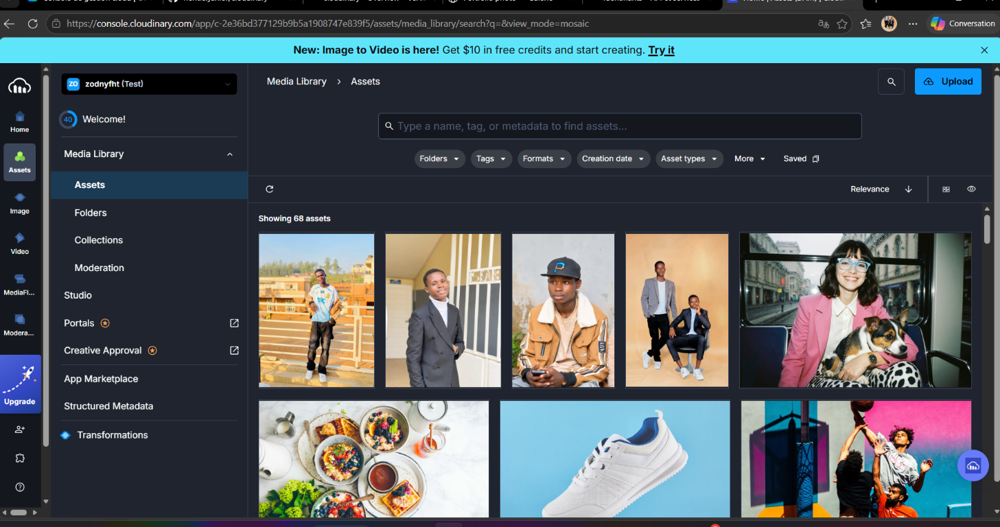

<div align="center">

# HERITIER JR · Portfolio photo

### Des visages. Des histoires.

J’ai créé ce portfolio pour présenter mon travail photographique dans une galerie élégante, immersive et adaptée à tous les écrans. J’y partage une sélection de portraits hébergés sur Cloudinary, ainsi que ma démarche et ma façon d’aborder une séance photo.

[Voir le site](https://cloudinary-one-flame.vercel.app) · [Voir le dépôt GitHub](https://github.com/heritierjunior/cloudinary)


</div>

---

## Mon espace Cloudinary

J’utilise Cloudinary pour héberger et diffuser les images de mon portfolio. Cette capture montre ma bibliothèque de médias dans la console Cloudinary.

<p align="center">
  
</p>

## À propos du projet

J’ai réalisé ce site en **HTML, CSS et JavaScript natifs**, sans framework. Mon objectif était de mettre les portraits au premier plan tout en créant une expérience complète : une introduction à mon univers, une galerie interactive, une présentation de ma démarche et des moyens simples de me contacter.

### Ce que j’ai créé

- Une galerie de quatre portraits, avec filtres par catégorie, recherche et tri.
- Une mosaïque responsive ; chaque photo s’ouvre dans une fiche détaillée avec titre, description, catégorie, date et Public ID Cloudinary.
- Des actions depuis la fiche photo : précédent/suivant, favoris, partage, copie du Public ID ou de l’URL, ouverture de l’image Cloudinary et téléchargement.
- Un menu hamburger sur téléphone pour naviguer entre la galerie et la présentation.
- Des favoris enregistrés dans le navigateur et le partage d’un lien vers une photo précise.
- Des sections éditoriales pour présenter mon approche et mon travail, sans ajouter d’images décoratives.
- Un profil de compte Google avec nom, adresse e-mail et photo de profil.
- Des boutons de contact qui ouvrent un message Gmail ou une conversation WhatsApp.
- Une interface adaptée aux ordinateurs et aux téléphones.

## Comment j’utilise Cloudinary

Les images de la galerie sont hébergées sur Cloudinary : je ne stocke donc pas de copies des photos dans ce dépôt. Dans `script.js`, je construis les URL d’images à partir de mon cloud name et des Public IDs.

J’applique des transformations directement dans les URL Cloudinary :

| Transformation | Utilisation |
| --- | --- |
| `f_auto` et `q_auto` | Laisser Cloudinary choisir le format et une qualité adaptée. |
| `w_...` | Demander la largeur nécessaire selon l’usage. |
| `c_fill`, `g_auto`, `ar_4:5` | Recadrer les vignettes dans un format cohérent en gardant un cadrage automatique. |
| `c_limit` | Limiter la taille de l’image ouverte dans la visionneuse. |

J’ajoute aussi `srcset` et `sizes` pour laisser le navigateur choisir une taille responsive. `loading="lazy"` et `decoding="async"` évitent de charger et décoder toutes les images dès l’ouverture de la page.

Mon cloud name est `zodnyfht`. Les Public IDs utilisés sont :

| Photo | Public ID |
| --- | --- |
| Portrait à deux | `portfolio/portrait-duo` |
| Portrait avec casquette | `portfolio/portrait-regard` |
| Portrait en veston | `ortfolio/portrait-elegance` |
| Portrait urbain | `portfolio/portrait-urbain` |

Le dossier `ortfolio` est écrit ainsi dans Cloudinary ; je conserve donc ce Public ID tel quel dans le code.

## Connexion Google

J’ai ajouté Google Identity Services pour permettre à la personne qui visite le site de choisir un compte Google et afficher son profil dans l’interface. Après la connexion, le site présente le nom, l’adresse e-mail et la photo de profil. Les boutons Apple et GitHub sont affichés comme options à venir, mais ne sont pas encore configurés.

Pour tester la connexion sur un autre domaine, il faut ajouter **l’origine exacte du site** dans Google Cloud Console → **API et services → Identifiants → Origines JavaScript autorisées**. Par exemple, pour GitHub Pages, l’origine est `https://heritierjunior.github.io` (sans chemin ni barre oblique finale).

> **À savoir :** le site est statique. La connexion Google sert ici à présenter un profil ; elle ne protège pas l’accès aux photos. Les URL Cloudinary sont publiques et peuvent être consultées indépendamment de la connexion. Il ne faut jamais ajouter de secret OAuth ou de clé privée dans le code du navigateur.

## Lancer le site sur mon ordinateur

Le projet n’a pas besoin d’installation de dépendances ni de compilation. Depuis le dossier du projet, je lance un serveur local :

```bash
python -m http.server 8000
```

Puis j’ouvre <http://localhost:8000>. Le flux Google ne fonctionne pas en ouvrant directement `index.html` avec une adresse `file://`.

Pour que la connexion locale fonctionne, j’ajoute `http://localhost:8000` et `http://127.0.0.1:8000` aux origines JavaScript autorisées du client OAuth.

## Structure du projet

| Fichier ou dossier | Rôle |
| --- | --- |
| `index.html` | Structure des pages, de la galerie, du profil et des sections éditoriales. |
| `styles.css` | Identité visuelle, mise en page responsive et états interactifs. |
| `script.js` | Photos Cloudinary, filtres, recherche, favoris, partage et visionneuse. |
| `auth.js` | Connexion Google, affichage du profil et déconnexion. |
| `docs/images/` | Capture Cloudinary intégrée à ce README. |

## Me contacter

Pour discuter d’une séance photo, j’ai relié les boutons du site à mes coordonnées :

- **E-mail :** [heritierbambu00@gmail.com](mailto:heritierbambu00@gmail.com)
- **WhatsApp :** [+243 814 313 997](https://wa.me/243814313997)

---

<div align="center">
  Réalisé par <strong>HERITIER JR</strong> · Portfolio photographique
</div>
